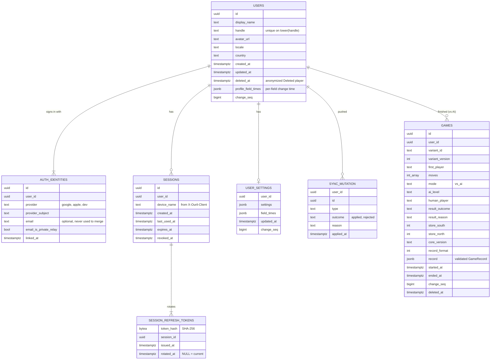
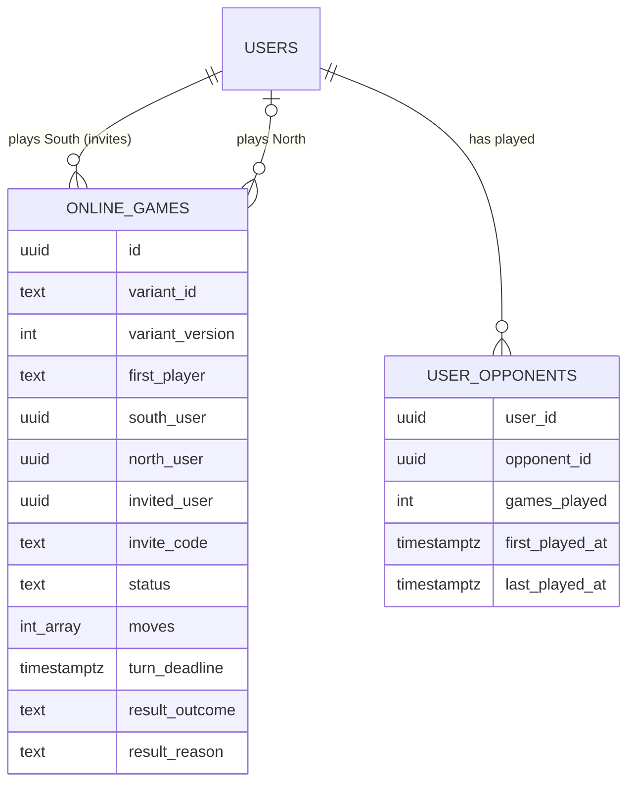

# Backend

> Design of `apps/server` (Rust): accounts and sync first (built, switched off for the web MVP, [ADR 0025](../decisions/0025-web-first-static-mvp.md)), real-time and async multiplayer later. **Status:** Accepted (stack). Details are Draft.

## Stack

- **Rust:** **Axum** for HTTP, **Tokio** runtime, **sqlx** for Postgres.
- **Postgres** for durable data (from the MVP).
- **No Redis on the current hosting.** Matchmaking seeks live in Postgres, and live-game messages go out through a realtime relay on the homelab ([ADR 0033](../decisions/0033-live-games-http-moves-and-relay.md), Proposed; [below](#realtime)).
- **Homelab services** (the relay, scheduled jobs) call or are called by this server, and are never the source of truth ([ADR 0032](../decisions/0032-small-services-on-the-homelab.md), Proposed; [deployment](deployment.md#the-homelab)).
- Uses `ouril-engine` directly to validate moves, and `ouril-protocol` for request and message types shared with every client.
- **Push notifications:** APNs (iOS), FCM (Android), Web Push (browsers).
- **Auth:** verifies Google and Apple ID tokens and issues our own sessions. See [accounts](../product/features/accounts.md).

## Scope by phase

| Phase ([roadmap](../product/roadmap.md)) | Server responsibilities |
|---|---|
| 1 · MVP | None: the web MVP is a static site |
| 2 · Accounts and sync | Sign in (Google, Apple), profile, account deletion, offline-first sync of game history and settings (guests never call the server). Built; deployed on Vercel ([deployment](deployment.md#the-server-on-vercel)) |
| 3 · Reach and replay | No new server work (pass-and-play and sharing are on-device) |
| 4 · Play with friends (async) | ✅ Turn-by-turn games over HTTP with invitations by handle, link or past opponent ([ADR 0031](../decisions/0031-online-games-over-http.md)). Still to come: friends list, push notifications |
| 5 · iOS and Android | Native push (APNs, FCM) |
| 6 · Live games | Live games over HTTP with clocks computed from timestamps, publishing each move to the homelab relay; matchmaking seeks in Postgres; rated games ([ADR 0033](../decisions/0033-live-games-http-moves-and-relay.md), Proposed) |
| 7 · Leaderboards | Glicko-2 ratings (overall and per variant and mode) updated when a rated game ends; world and country boards from Postgres ([ADR 0034](../decisions/0034-ratings-and-leaderboards-in-postgres.md), Proposed); later, snapshots by a homelab job through `POST /v1/internal/jobs/<name>` |
| Ongoing | More sign-in providers (X, Meta), tournaments |

## Data model

The MVP schema is implemented in [`apps/server/migrations/20261004000001_init.sql`](../../apps/server/migrations/20261004000001_init.sql). Games against other players add `online_games` and `user_opponents` ([below](#games-against-other-players)).

- `AUTH_IDENTITIES` is unique on `(provider, provider_subject)`. One user can link several providers.
- Email is **optional**. Apple may hide it behind a relay address, and X may not provide one at all.
- **Refresh tokens rotate within a session.** Every token ever issued is kept as a SHA-256 hash in `SESSION_REFRESH_TOKENS`. Presenting a rotated one again revokes the whole session (reuse detection).
- **The profile is the `USERS` row**, which carries its own `change_seq`, so profile changes come down in pull.
- `GAMES` holds finished games vs AI in the MVP (`mode = vs_ai`, ID generated on the device). `record` is the exact `GameRecord` the client pushed, once the server has replayed it. Online games will reuse this table, so there's one history.
- **Stats aren't stored as counters.** They're derived from game records by `ouril-sync` (`derive_stats`), and may be cached in a table that can be rebuilt.
- Synced tables carry `change_seq` (one Postgres sequence, `change_seq`) for [offline sync](data-and-sync.md). `GAMES` also has `deleted_at` for deletion markers.
- **Account deletion** deletes sessions (and their refresh tokens), identities, settings, games, sync history and the player's own opponent list, as the privacy policy states. Other players keep their rows about them, which then show the anonymized player. It turns the `USERS` row into an anonymized "Deleted player" (`deleted_at` set).

### Games against other players

Built for turn-by-turn play ([ADR 0031](../decisions/0031-online-games-over-http.md), [API](../../apps/server/API.md#games-against-other-players), `apps/server/src/online.rs`).

- **`online_games`** ([`20261013000002_online_games.sql`](../../apps/server/migrations/20261013000002_online_games.sql)) holds each game: the variant (pinned `id@version`), who plays South (the inviter) and North, the invited player or the invite link's code, the `status`, the **moves** (one array, replayed with the engine), the turn deadline and the result. The server accepts a move only from the player to move, at the expected `ply`, when the engine says it's legal. Time-based changes (a missed deadline, an expired invitation) are applied whenever a game is read or written; there's no background job.
- **When a game ends**, each player gets a format-3 record in `GAMES` (`mode = vs_player`, their side, the opponent), which sync pull delivers, and the pair counts in `user_opponents`.
- **`user_opponents`** ([`20261013000001_user_opponents.sql`](../../apps/server/migrations/20261013000001_user_opponents.sql), `apps/server/src/opponents.rs`) records who has played against whom: one row per player per opponent, stored in both directions, with the games played and the first and **last played at**. It feeds "people you've played" (`GET /v1/opponents`) and, later, friends. Games against the computer never appear in it.
- **Account deletion** cancels the player's invitations, resigns their active games (the opponent wins and keeps the game against "Deleted player"), and deletes their own opponent list.

## API

The full contract is in [`apps/server/API.md`](../../apps/server/API.md): request and response shapes, errors, cookies and sync rules. MVP endpoints, all implemented:

| Method | Path | Purpose |
|---|---|---|
| `GET` | `/healthz` | Liveness: the process is up (`200 ok`, outside `/v1`) |
| `GET` | `/readyz` | Readiness, for manual and post-deploy checks: `200 ok` if the database answers within 2 s, else `503` (outside `/v1`). Not Fly's health check, so the database can sleep ([ADR 0027](../decisions/0027-postgres-on-neon-free-plan.md)) |
| `GET` | `/v1/meta` | Minimum supported and recommended app versions, API and protocol versions ([versioning](versioning.md)) |
| `POST` | `/v1/auth/dev` | **Debug builds only** (`dev-auth` feature): sign in as a test user without Google or Apple ([ADR 0017](../decisions/0017-local-first-development.md)). The user is found or created by name (default `dev`). |
| `POST` | `/v1/auth/google` | Exchange a Google ID token for our session. `501 not_configured` while `GOOGLE_CLIENT_ID` is empty. |
| `POST` | `/v1/auth/apple` | Exchange an Apple identity token (+ first-time name) for our session. `501 not_configured` while any `APPLE_*` is empty. |
| `POST` | `/v1/auth/refresh` | Rotate the refresh token, get a new access token |
| `POST` | `/v1/auth/logout` | Revoke the current session |
| `GET` / `PATCH` | `/v1/me` | Read and update the profile (display name, handle, avatar, locale, country) |
| `DELETE` | `/v1/me` | Delete the account (required by Apple and Google Play) |
| `POST` | `/v1/sync/push` | Upload queued local changes (game records, profile, settings, handle). Repeats are ignored by mutation ID. |
| `GET` | `/v1/sync/pull?cursor=N&limit=M` | Download the user's changes since cursor `N` |

Games against other players use `/v1/games…` and `/v1/opponents` (built, [API](../../apps/server/API.md#games-against-other-players)). Live games will add seek endpoints, relay tokens and clocks ([below](#realtime)); the WebSocket itself is the homelab relay's, not this server's.

## As built (MVP)

- **Crate layout:** `apps/server` is a library plus a thin binary, so the integration tests build the same router. `ouril-server migrate` applies migrations; production runs them with `sqlx migrate run` in the deploy workflow. Debug builds also apply them on startup.
- **Sessions:** the access token is a JWT (HS256, `JWT_SECRET`) with `sub`, `sid`, `iss = ouril`, `aud = ouril-api`, valid for 15 minutes by default. Every signed-in request also checks in the database that the session is live, so logout and deletion take effect at once. Refresh tokens are opaque, last 30 days by default, and each refresh extends the session.
- **Web vs native:** a request with an `Origin` from `ALLOWED_ORIGINS` is treated as the web app. The web app gets the refresh token as an httpOnly cookie, `ouril_refresh` (`SameSite=Lax`, `Path=/v1/auth`, `Secure` except on `http://localhost`), and never in the body. A disallowed `Origin` on `/v1/auth/*` gets 403. The web app holds a cross-tab lock (`navigator.locks`) while it refreshes, so two tabs don't trip reuse detection.
- **Google and Apple:** ID-token verification is written (cached key set, issuer, audience, expiry, nonce) and unit-tested offline with a test key. It hasn't been tested with real tokens. Revoking the Apple token on account deletion is still a TODO.
- **Sync validation:** `game_finished` records are replayed with `ouril-engine` at the exact `variant@version`. A record whose moves are illegal, or whose outcome, stores or end reason don't match, is rejected as `illegal_game`. Forfeits (format 2, reason `resigned`) must replay to a game still in progress, with the other side winning ([ADR 0022](../decisions/0022-forfeit-and-record-format-2.md)). Each mutation runs in its own transaction, and a repeated mutation ID returns the stored outcome.
- **Middleware:** `X-Ouril-Client` is parsed on every request, and clients below `min_supported` get `426` on every `/v1` route except `/v1/meta`. CORS allows exact origins with credentials. Other middleware: security headers (plus HSTS in release builds), a 1 MiB body limit, a 15 s timeout per request, JSON errors for every failure (including panics and malformed input), and request logs that never record headers or bodies.
- **Proxy secret (optional):** with `ORIGIN_SECRET` set, `/v1` only answers requests carrying `x-ouril-origin-secret` with that value (403 `forbidden` otherwise, constant-time check). It was for an external proxy ([ADR 0029](../decisions/0029-api-through-vercel-proxy.md)); on Vercel the server is only reachable through Vercel, so it's unset ([ADR 0030](../decisions/0030-server-on-vercel-container-service.md)).
- **Rate limiting:** in-memory fixed windows per server machine, keyed by client network (IPv4 address or IPv6 /64), from the header named by `CLIENT_IP_HEADER` (`x-real-ip` on Vercel, which sets it on every request), else the peer address. Without that setting no header is trusted. Sign-in is limited to 60/min; everything else, including refresh and logout, to 600/min. Both are configurable. The map is capped at 50,000 windows and pruned at most every 10 s; when it's full, new clients pass untracked instead of being locked out. `429` comes with `Retry-After`. There's no shared store on the current hosting, so counters stay per instance.
- **Startup:** the server pings the database in the background (`SELECT 1`, 3 attempts 2 s apart, 5 s each) and logs `database reachable`, or a warning per failed attempt and an error if all fail. It keeps serving either way, so a brief outage doesn't make Fly restart machines in a loop.
- **Release safety:** a release build with `dev-auth` fails to compile, and the production image never enables it. Release builds refuse to start with the `.env.example` JWT secret or a non-loopback `http://` origin, and `ouril-server migrate` refuses a read-only database (a read replica's URL, [ADR 0027](../decisions/0027-postgres-on-neon-free-plan.md)).

## Migrations

The schema lives in `apps/server/migrations` as plain SQL, forward-only, applied with sqlx. The same files run against local Docker Postgres and against Neon in production ([ADR 0027](../decisions/0027-postgres-on-neon-free-plan.md)); nothing Neon-specific is needed.

1. **Create one:** `just migration <name>` (for example `just migration add_friends`) writes an empty `apps/server/migrations/<next number>_<name>.sql`. Write the SQL there.
2. **Try it locally:** `just dev` applies it on startup (debug builds), or run `just migrate`. `just db-reset` replays every migration from scratch. Every `#[sqlx::test]` gets a fresh database with all migrations applied, so `just test-server` runs against the new schema.
3. **Ship it:** merge. The deploy workflow (`deploy-web.yml`) runs `sqlx migrate run` against Neon before deploying; it applies only the migrations Neon hasn't seen and records them in `_sqlx_migrations`. A failing migration stops the deploy and the running version keeps serving.

Rules:

- **Never edit a migration after it's merged.** sqlx stores each one's checksum, and a changed file makes `migrate` fail on every database that already ran it. Fix mistakes with a new migration.
- **Expand, then contract** ([versioning](versioning.md#data-migrations)). During a rolling deploy the old code runs against the new schema, so add columns and tables first, and drop or rename them in a later release.
- **Keep migrations transactional and short:** each runs in a transaction, and a long lock blocks live requests.
- **Risky change on real data?** Create a branch of the production database in Neon's console (a free copy), then run against its direct connection string: `docker compose run --rm -e DATABASE_URL='<branch url>' toolbox sqlx migrate run --source apps/server/migrations`. Delete the branch afterwards.

## Realtime

Not built; [ADR 0033](../decisions/0033-live-games-http-moves-and-relay.md) (Proposed). Players send everything to this server over HTTP; the homelab relay only carries the server's messages back out ([deployment](deployment.md#the-homelab)).

- **Client → server (HTTP):** `POST /v1/games/{id}/moves {ply, pit}`, resign, draw offers, abort, seeks (`/v1/live/seek`), and a relay token (`POST /v1/live/token`).
- **Server → relay (HTTP, API key):** after each committed change, publish to `game:<id>` (`moved {ply, pit, clocks, server_now}`, `game_over {result}`, draw offers) or `user:<id>` (`matched {game_id}`, invitations).
- **Relay → client (WebSocket):** the same messages, to subscribers whose token allows that channel. Tokens are short-lived, signed by this server, and limited to the player's own game and user channels.
- **Fallback:** without the relay, clients poll `GET /v1/games/{id}` (every second while a live game is on screen), as turn-by-turn games do.
- Each move carries its **ply number**, so the server rejects stale or duplicate moves (idempotent). Clients apply their own move **optimistically** with the same engine.
- **Clocks:** each live game stores both players' remaining time, the increment and `turn_started_at`. A move deducts the elapsed server time and adds the increment; a side out of time loses, settled whenever the game is next read or written (as async deadlines are, [ADR 0031](../decisions/0031-online-games-over-http.md)). Responses include `server_now`.
- **Matchmaking:** a `seeks` table. A new seek looks for a compatible waiting one in the same transaction (`FOR UPDATE SKIP LOCKED`) within a rating window that widens with waiting time; seeks without a recent heartbeat are ignored.
- **Async** games use `POST /v1/games/{id}/moves` over HTTP (built). Push notifications are still to come.

### Scheduled jobs

Housekeeping that must run more often than Vercel's daily cron runs from a crontab on the homelab, as `POST /v1/internal/jobs/<name>` with `Authorization: Bearer <JOBS_TOKEN>` ([ADR 0032](../decisions/0032-small-services-on-the-homelab.md)). Each job is idempotent and safe to run late or twice; nothing depends on it running on time, because games settle on access anyway. Candidates: leaderboard snapshots, pruning expired seeks, sessions and sync mutations ([human review](../review/human-review.md)), and database backups.

## Operations

- **Hosting:** a container service in the web app's Vercel project (`apps/server/Dockerfile.vercel`, region `fra1`), serving `/v1` on the same origin; it scales to zero when idle. Migrations run in the deploy workflow, settings come from the `production` GitHub environment, and there's no hosted staging ([ADR 0030](../decisions/0030-server-on-vercel-container-service.md), [ADR 0028](../decisions/0028-production-only-local-staging.md)). Postgres is on Neon's free plan in AWS Frankfurt, one project ([ADR 0027](../decisions/0027-postgres-on-neon-free-plan.md)). Deploys and setup: [deployment](deployment.md#the-server-on-vercel).
- Stateless app instances (Vercel Functions). Live games aren't pinned to an instance: state is in Postgres and delivery goes through the homelab relay ([ADR 0033](../decisions/0033-live-games-http-moves-and-relay.md), Proposed).
- Observability: structured logs (`tracing`), metrics, error tracking (for example Sentry).
- Secrets (Apple private key, push credentials) live in the host's secret manager, never in the repo.

## Open questions

- Data residency and GDPR requirements (EU diaspora players).
