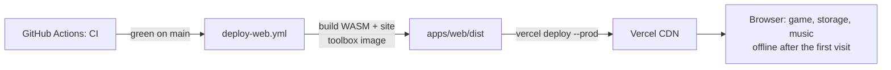
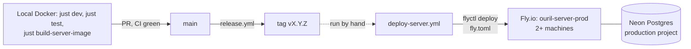

# Deployment

> How the MVP web app is built and deployed to Vercel, how the server is deployed to Fly.io with its database on Neon, and what changes when accounts are switched on. **Status:** Accepted. See [ADR 0025](../decisions/0025-web-first-static-mvp.md), [ADR 0019](../decisions/0019-host-server-on-fly-io.md) and [ADR 0027](../decisions/0027-postgres-on-neon-free-plan.md).

## The MVP: a static site

The MVP is the web app alone. Its build (`apps/web/dist`) is a static site: HTML, JavaScript, the WASM rules engine, the 3D board, fonts, images and music. It needs **no server and no database**.

- **Why it's built in GitHub Actions:** the WASM engine is compiled from Rust, and Vercel's build image has no Rust toolchain. [`.github/workflows/deploy-web.yml`](../../.github/workflows/deploy-web.yml) runs after CI passes on `main` (or by hand). It builds the WASM engine and the site with the same toolbox image as CI ([ADR 0017](../decisions/0017-local-first-development.md)), copies `apps/web/vercel.json` into the build, and uploads it with `vercel deploy --prod`.
- **`vercel.json`** turns off Vercel's own Git deployments (`git.deploymentEnabled: false`): a build on Vercel fails because `ouril-wasm` (`core/wasm/pkg`) can't be compiled there. It also carries the SPA routing (every path except assets, icons, audio and the service worker serves `index.html`), the security headers (HSTS, CSP with `connect-src` limited to the site and the Matomo host, etc.) and a 404 for missing `/audio/` files.
- **Environment variables:** only usage statistics ([ADR 0026](../decisions/0026-usage-statistics-with-matomo.md)). The workflow builds with `VITE_MATOMO_URL=https://analytics.moreiralabs.org/` and `VITE_MATOMO_SITE_ID=1` (repository variables of the same name override them), and the CSP's `connect-src` allows that host; a different host needs both changed. Players are asked on first launch and nothing is sent without consent. Sign-in and Stats are off by default (`VITE_FEATURE_ACCOUNTS`, `VITE_FEATURE_STATS`), and with no `VITE_SENTRY_DSN` crash reports aren't offered. Local builds set none of these, so development sends nothing.
- **Offline:** the service worker precaches the app (about 2 MB) and downloads the game music into its own cache while the browser is idle ([web design](web-design.md)).

## One-time setup

1. Create a Vercel project for the repository with **Framework: Other**, **no build command** and **output directory `.`** (the uploaded folder is already the built site).
2. Add the repository secrets **`VERCEL_TOKEN`**, **`VERCEL_ORG_ID`** and **`VERCEL_PROJECT_ID`** (GitHub → Settings → Secrets and variables → Actions). Until `VERCEL_TOKEN` exists, the workflow skips the deploy.
3. Point the domain at the Vercel project. HTTPS is automatic, and required for the service worker and installing the app.
4. In Matomo (site 1), keep the privacy settings ADR 0026 relies on: **Anonymize IP addresses** (at least 2 bytes, also used for location), **no location from IP** (or the anonymized IP only), and a data-retention period. Add the production domain to the site's URLs.

## Releasing

Merge to `main`. CI runs; when it's green, `deploy-web.yml` deploys that exact commit to production. A failed CI run never deploys. Players get the new version on their next visit (the service worker updates itself, `registerType: autoUpdate`).

## The server on Fly.io

The Rust server (`apps/server`) runs on Fly.io in Frankfurt (`fra`) ([ADR 0019](../decisions/0019-host-server-on-fly-io.md)), and its Postgres database on Neon's free plan in AWS Frankfurt ([ADR 0027](../decisions/0027-postgres-on-neon-free-plan.md)). **Only production is deployed:** the local Docker stack is the staging environment ([ADR 0028](../decisions/0028-production-only-local-staging.md)).

- **Before deploying:** check the change locally. `just dev` runs the server against local Postgres, `just test` runs every test, and `just build-server-image` builds the exact production image.
- **Workflow:** [`.github/workflows/deploy-server.yml`](../../.github/workflows/deploy-server.yml) runs only by hand, with a release tag (`vX.Y.Z`, which `release.yml` creates on every merge to `main`), and only if CI passed on that commit. Tags pushed by `release.yml` can't trigger workflows, so every deploy is a deliberate promotion. On its first run it also creates the Fly app and its secrets (see the setup below).
- **Image:** Fly's remote builder builds `apps/server/Dockerfile`, which never enables `dev-auth` (CI's release-image job checks the same Dockerfile).
- **Config:** `apps/server/fly.toml` (`ouril-server-prod`, `min_machines_running = 2`, JSON logs).
- **Migrations** are embedded in the binary and run as the release command (`ouril-server migrate`) before new machines take traffic. A failed migration stops the deploy, and the old machines keep serving.
- **Health:** Fly's health check is `/healthz` (liveness, no database call), so checks don't keep the Neon database awake. `/readyz` checks the database (200 within 2 s, else 503); open it after each deploy.
- **Database connection:** `DATABASE_URL` is Neon's **direct** connection string for the **primary** compute (host without `-pooler`), with `sslmode=require`. The project has a read replica that the server doesn't use ([ADR 0027](../decisions/0027-postgres-on-neon-free-plan.md)): sessions are checked on every request and sync pull follows a push, so replica lag would show stale data. `ouril-server migrate` refuses a read-only database, so a replica's connection string stops the deploy at the release command. Neon's pooled URL runs PgBouncer in transaction mode, which breaks sqlx's named prepared statements and the migrator's advisory lock. The server closes connections idle for 4 minutes, so Neon can suspend the compute after its 5 idle minutes; the first query after that waits a few hundred milliseconds while it wakes.
- **Free-plan limits:** the Neon project gets 0.5 GB of storage and 100 compute-hours a month. When it runs out of compute-hours, Neon suspends it until the next month and the API fails. Count the read replica too if anything connects to it. Check usage in Neon's console, and move to a paid plan before there are steady daily players.
- **Secrets:** only `DATABASE_URL` and `JWT_SECRET` are required. Leave the Google and Apple variables unset until their keys exist (those routes answer `501 not_configured`). Every other setting has a default or is in the Fly config.

## One-time setup for the server

Everything happens in three websites (Neon, Fly.io and GitHub); you don't need `flyctl` on your machine. The deploy workflow runs `flyctl` in GitHub Actions: on its first run it creates the Fly app, copies `DATABASE_URL` into the app's secrets, and generates `JWT_SECRET` (once; it's never replaced, so players stay signed in across deploys).

1. **Neon** (free account at neon.com): create a project in **AWS Europe Central 1 (Frankfurt)**. Ignore the CLI setup steps Neon suggests; only the connection string is needed. Open **Connect**, keep the default branch, choose the **primary** compute (not the read replica) in the **Compute** menu, turn **Connection pooling off** and copy the connection string (the host has no `-pooler`).
2. **Fly.io** (account at fly.io, with a payment method once the trial ends): open the dashboard, choose your organization, then **Tokens**, and create an **organization token**. It must be org-scoped, not an app token, because the workflow creates the app. Note the organization's slug (`personal` for a personal account).
3. **GitHub:** Settings → Environments → `production` (the existing environment, also used by the web deploy), and add the secrets `FLY_API_TOKEN` (the Fly token) and `DATABASE_URL` (the Neon connection string; paste it straight into GitHub, it contains the database password). If your Fly organization isn't `personal`, add a repository variable `FLY_ORG` with its slug. **Required reviewers** on that environment would also gate every web deploy.
4. **First deploy:** Actions → *Deploy server* → *Run workflow*, with the latest release tag (Releases page, for example `v0.5.0`). Then open `https://ouril-server-prod.fly.dev/readyz` in a browser: it should say `ok`, and `/v1/meta` should return JSON.
5. **Alerts:** in the Fly dashboard, set a spending alert on the organization (ADR 0019). In Neon, check the project's compute-hours now and then.

To change the database, update `DATABASE_URL` in the GitHub environment; the next deploy copies it to Fly. An app name is global on Fly: if the first deploy says `ouril-server-prod` is taken, change `app` in `apps/server/fly.toml` and run it again. The org token can manage every app in the organization, so keep this organization for Ouril, or replace the token with an app deploy token (the app's **Tokens** tab) once the app exists.

### Browse the production database

`docker/pgadmin/compose.neon.yaml` runs pgAdmin for the Neon database as its own Compose project, independent of the local stack (which has its own pgAdmin for the local database, `just pgadmin` on port 5050).

1. Copy `docker/pgadmin/.env.example` to `docker/pgadmin/.env` (gitignored). Set a pgAdmin login (`PGADMIN_DEFAULT_EMAIL`, `PGADMIN_DEFAULT_PASSWORD`), and `NEON_HOST`, `NEON_USER` and `NEON_DATABASE` from Neon's **Connect** dialog with the **primary** compute selected.
2. Start it with `just pgadmin-neon` (or `docker compose -f docker/pgadmin/compose.neon.yaml up -d`), open <http://localhost:5051> and sign in. The server "Ouril production (Neon)" is already listed. Enter the Neon password on first connect; pgAdmin can save it in its volume.
3. **Stop it when you're done** (`just pgadmin-neon-down`). While pgAdmin is connected, its dashboards query the database every few seconds, which keeps the Neon compute awake and spends the free plan's compute-hours.

It listens on `127.0.0.1` only and asks for its own login, because it can change production data. The Neon password never goes in a file. The server list is loaded on the first start only: after changing `NEON_*`, reset with `docker compose -f docker/pgadmin/compose.neon.yaml down -v` (that also forgets the saved password). For a quick query, Neon's console **SQL Editor** needs no setup at all.

Browsers don't call `ouril-server-prod.fly.dev` directly: the web app forwards `/v1` to it ([ADR 0029](../decisions/0029-api-through-vercel-proxy.md), [below](#switching-accounts-on)).

## Switching accounts on

Turning on accounts and sync ([ADR 0009](../decisions/0009-oauth-accounts-google-apple.md)) connects the web app to the server above. The browser calls `https://ouril.vercel.app/v1/…`, and Vercel forwards it to `https://ouril-server-prod.fly.dev/v1/…` (the `routes` entry in `apps/web/vercel.json`), so the API is same-origin and the refresh cookie is first-party ([ADR 0029](../decisions/0029-api-through-vercel-proxy.md)). Vercel adds the header `x-ouril-origin-secret` from its `ORIGIN_SECRET` environment variable, and the server refuses `/v1` requests without it; it rate-limits on the visitor IP Vercel sends in `x-real-ip`. That release also:

- creates the shared secret (for example `openssl rand -hex 32`) and stores it twice: as the secret `ORIGIN_SECRET` in the `production` GitHub environment (the server deploy copies it to Fly), and as the environment variable `ORIGIN_SECRET` in the Vercel project (Settings → Environment Variables, Production). Vercel reads it on each request, so no web rebuild is needed when it changes, but both sides must match or every `/v1` call gets 403;
- sets the GitHub variables `VITE_FEATURE_ACCOUNTS=true` (and `VITE_FEATURE_STATS=true`). `deploy-web.yml` builds with them (Vercel's own environment variables aren't used for the build: the site is built in GitHub Actions), plus `VITE_GOOGLE_CLIENT_ID` from the `GOOGLE_CLIENT_ID` secret. `VITE_API_BASE_URL` stays empty, because the API is same-origin;
- adds `https://<domain>/auth/google` to the Google client's redirect URIs ([accounts](../product/features/accounts.md#setting-up-the-google-client)). The same `GOOGLE_CLIENT_ID` secret is copied to Fly by the server deploy;
- keeps `ALLOWED_ORIGINS = "https://ouril.vercel.app"` in `apps/server/fly.toml` in step with the web address, and sets the Apple keys later;
- publishes the privacy policy and the account-deletion page.

## Open questions

- The production domain.
- Scheduled `pg_dump` backups to object storage (ADR 0019): where they go, and when the first restore test happens.
