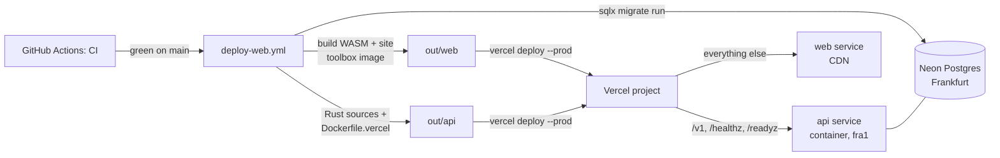
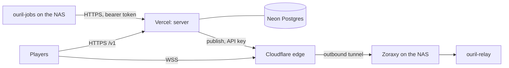

# Deployment

> How the web app and the server are built and deployed to one Vercel project, with the database on Neon; how small services are built and deployed to the homelab; and what to set when accounts are switched on. **Status:** Accepted (Vercel and Neon); the homelab section is Proposed. See [ADR 0025](../decisions/0025-web-first-static-mvp.md), [ADR 0030](../decisions/0030-server-on-vercel-container-service.md), [ADR 0027](../decisions/0027-postgres-on-neon-free-plan.md) and [ADR 0032](../decisions/0032-small-services-on-the-homelab.md).

## Overview

One Vercel project serves everything at `https://ouril.vercel.app`, as two services ([ADR 0030](../decisions/0030-server-on-vercel-container-service.md)):

- **`web`:** the static site (`apps/web/dist`): HTML, JavaScript, the WASM rules engine, the 3D board, fonts, images and music. Guests need nothing else.
- **`api`:** the Rust server (`apps/server`) as a container, built by Vercel from `apps/server/Dockerfile.vercel`. It serves `/v1`, `/healthz` and `/readyz` on the same origin, and talks to Postgres on Neon in Frankfurt.

- **Workflow:** [`.github/workflows/deploy-web.yml`](../../.github/workflows/deploy-web.yml) runs after CI passes on `main`, or by hand. It builds the WASM engine and the site with the same toolbox image as CI ([ADR 0017](../decisions/0017-local-first-development.md)), because Vercel's build image has no Rust toolchain. It checks that `DATABASE_URL` accepts writes, runs the migrations, assembles `out/` (`vercel.json`, `web/`, and `api/` with the Rust workspace and the Dockerfile), and uploads it with `vercel deploy --prod`. Vercel then builds the server image. A failed CI run never deploys.
- **`apps/web/vercel.json`** defines the two services and the routing. It turns off Vercel's own Git deployments (`git.deploymentEnabled: false`), because a build from the repository on Vercel would fail on `ouril-wasm`. The `web` service carries the SPA routing (every path except assets, icons, audio and the service worker serves `index.html`) and the security headers (HSTS, CSP with `connect-src` limited to the site and the Matomo host, etc.).
- **Server settings** go to the deployment as runtime environment variables from the `production` GitHub environment (`vercel deploy --env`), so nothing needs setting in Vercel's dashboard: `DATABASE_URL`, `JWT_SECRET`, `GOOGLE_CLIENT_ID`, `ALLOWED_ORIGINS` (`https://ouril.vercel.app`, or the variable of that name), `CLIENT_IP_HEADER=x-real-ip`, `PORT=8080` and JSON logs.
- **Web build variables:** usage statistics ([ADR 0026](../decisions/0026-usage-statistics-with-matomo.md)), built with `VITE_MATOMO_URL=https://analytics.moreiralabs.org/` and `VITE_MATOMO_SITE_ID=1` (repository variables of the same name override them; the CSP's `connect-src` must allow the host), and the accounts flags below. Local builds set none of these, so development sends nothing.
- **Offline:** the service worker precaches the app (about 2 MB) and downloads the game music into its own cache while the browser is idle ([web design](web-design.md)).
- **Only production is deployed:** the local Docker stack is the staging environment ([ADR 0028](../decisions/0028-production-only-local-staging.md)). Before merging, check the change locally: `just dev`, `just test`, and `just build-server-image` for the production image. A manual run of *Deploy* with **preview** makes a deployment on its own URL without touching production (no migrations; sign-in doesn't work there, because its origin isn't allowed).

## Releasing

Merge to `main`. CI runs; when it's green, `deploy-web.yml` migrates the database and deploys that exact commit, web and server together. Players get the new site on their next visit (the service worker updates itself, `registerType: autoUpdate`). After a deploy that changes the server, open `https://ouril.vercel.app/readyz`: it should say `ok`.

## The server on Vercel

- **Image:** `apps/server/Dockerfile.vercel`, the same release build as `apps/server/Dockerfile` without BuildKit cache mounts. It never enables `dev-auth` (CI's release-image job checks the same build).
- **Scaling:** Vercel runs the container as a Function. It scales to zero after 5 idle minutes, and the next request waits for it to start. The in-memory rate limiter is per instance, and keys on `x-real-ip`, which Vercel sets on every request ([backend](backend.md)).
- **Region:** the project's Functions region must be Frankfurt (`fra1`), next to Neon (one-time setup below).
- **Migrations** are forward-only SQL in `apps/server/migrations` ([backend](backend.md#migrations)). `deploy-web.yml` runs `sqlx migrate run` before deploying; a failure stops the deploy and the running version keeps serving. Because every merge deploys the server, a migration must work with the code that's already running (expand, then contract).
- **Health:** `/healthz` (liveness) and `/readyz` (the database answers within 2 s, else 503) are routed to the server for manual checks. Vercel has no health checks of its own, so nothing keeps the database awake.
- **Logs:** the server's JSON logs are in the Vercel dashboard (project → Logs); the free plan keeps them for 1 hour.
- **Database connection:** `DATABASE_URL` is Neon's **direct** connection string for the **primary** compute (host without `-pooler`), with `sslmode=require`. The project has a read replica that the server doesn't use ([ADR 0027](../decisions/0027-postgres-on-neon-free-plan.md)): sessions are checked on every request and sync pull follows a push, so replica lag would show stale data. `deploy-web.yml` (and `ouril-server migrate`) refuse a read-only database, so a replica's connection string stops the deploy. Neon's pooled URL runs PgBouncer in transaction mode, which breaks sqlx's named prepared statements and the migrator's advisory lock. The server closes connections idle for 4 minutes, so Neon can suspend the compute after its 5 idle minutes; the first query after that waits a few hundred milliseconds while it wakes.
- **Free-plan limits:** Vercel Hobby includes 1M function invocations, 4 hours of active CPU and 360 GB-hours of memory a month, and is for non-commercial use (donations are fine). Neon's project gets 0.5 GB of storage and 100 compute-hours a month; when it runs out of compute-hours, Neon suspends it until the next month and the API fails. Check both dashboards now and then.

## One-time setup

Everything happens in the Vercel, Neon and GitHub websites.

1. **Vercel:** the project for the repository (Framework **Other**). Under **Settings → Functions**, set the **Function Region** to **Frankfurt, Germany (fra1)**. Add the repository secrets **`VERCEL_TOKEN`**, **`VERCEL_ORG_ID`** and **`VERCEL_PROJECT_ID`** (GitHub → Settings → Secrets and variables → Actions). Until `VERCEL_TOKEN` exists, the workflow skips the deploy.
2. **Neon** (free account at neon.com): a project in **AWS Europe Central 1 (Frankfurt)**. Open **Connect**, keep the default branch, choose the **primary** compute (not the read replica), turn **Connection pooling off** and copy the connection string (the host has no `-pooler`).
3. **GitHub:** Settings → Environments → `production` (used by `deploy-web.yml`), with the secrets:
   - `DATABASE_URL`: the Neon connection string (paste it straight into GitHub; it contains the database password);
   - `JWT_SECRET`: a long random value, for example from `openssl rand -base64 48`. Keep it stable: changing it signs every player out;
   - `GOOGLE_CLIENT_ID`: the Google OAuth client ID ([accounts](../product/features/accounts.md#setting-up-the-google-client)).

   **Required reviewers** on that environment would gate every deploy.
4. **First deploy:** Actions → *Deploy* → *Run workflow*. Try **preview** first, then **production**. Open `/readyz` on the deployment's URL: it should say `ok`, and `/v1/meta` should return JSON.
5. In Matomo (site 1), keep the privacy settings ADR 0026 relies on: **Anonymize IP addresses** (at least 2 bytes, also used for location), **no location from IP** (or the anonymized IP only), and a data-retention period. Add the production address to the site's URLs.

To change the database, update `DATABASE_URL` in the GitHub environment; the next deploy uses it.

### Browse the production database

`docker/pgadmin/compose.neon.yaml` runs pgAdmin for the Neon database as its own Compose project, independent of the local stack (which has its own pgAdmin for the local database, `just pgadmin` on port 5050).

1. Copy `docker/pgadmin/.env.example` to `docker/pgadmin/.env` (gitignored). Set a pgAdmin login (`PGADMIN_DEFAULT_EMAIL`, `PGADMIN_DEFAULT_PASSWORD`), and `NEON_HOST`, `NEON_USER` and `NEON_DATABASE` from Neon's **Connect** dialog with the **primary** compute selected.
2. Start it with `just pgadmin-neon` (or `docker compose -f docker/pgadmin/compose.neon.yaml up -d`), open <http://localhost:5051> and sign in. The server "Ouril production (Neon)" is already listed. Enter the Neon password on first connect; pgAdmin can save it in its volume.
3. **Stop it when you're done** (`just pgadmin-neon-down`). While pgAdmin is connected, its dashboards query the database every few seconds, which keeps the Neon compute awake and spends the free plan's compute-hours.

It listens on `127.0.0.1` only and asks for its own login, because it can change production data. The Neon password never goes in a file. The server list is loaded on the first start only: after changing `NEON_*`, reset with `docker compose -f docker/pgadmin/compose.neon.yaml down -v` (that also forgets the saved password). For a quick query, Neon's console **SQL Editor** needs no setup at all.

## The homelab

Small, optional services run on the developer's homelab: a UGREEN DH4300 Plus NAS (arm64, 8 GB RAM) behind an outbound-only Cloudflare Tunnel and the Zoraxy reverse proxy, documented in its own `home-lab` repository ([ADR 0032](../decisions/0032-small-services-on-the-homelab.md)). Usage statistics already run there ([ADR 0026](../decisions/0026-usage-statistics-with-matomo.md)). Both services below are built.

| Service | What it does | State |
|---|---|---|
| **Realtime relay** (`apps/relay`, `ouril-relay`, at `ouril-live.moreiralabs.org`) | Tells players over WebSocket when their game changed or a seek was matched. The server publishes to it; players subscribe with a token the server signs. Stores nothing ([ADR 0033](../decisions/0033-live-games-http-moves-and-relay.md), [relay API](../../apps/relay/API.md)) | ✅ Built |
| **Scheduled jobs** (`apps/jobs`, `ouril-jobs`) | Every hour, calls the server's job endpoints (`POST /v1/internal/jobs/<name>` with `JOBS_TOKEN`): `leaderboard-snapshot` (rank movement and best ranks) and `prune`. No inbound route ([backend](backend.md#scheduled-jobs)) | ✅ Built |

### Rules

- **Never the source of truth.** Every write goes through the Vercel server to Neon. A homelab service keeps no personal data beyond messages in flight.
- **Fail safe.** Every client path has a fallback: without the relay, live games poll (as turn-by-turn games do). Jobs are idempotent and safe to run late, twice, or not for a while.
- **Same hardening as `home-lab`:** read-only containers, `cap_drop: ALL`, `no-new-privileges`, no published ports. Zoraxy reaches services on `internal_public_apps`. Anything private to the stack goes on its own `internal` network.

### Security

It's a home network, so every homelab service assumes the internet is hostile.

- **Only what's needed is reachable.** Cloudflare's public hostname `ouril-live.moreiralabs.org` goes through the tunnel to Zoraxy, which routes it to the relay. The relay serves three paths: `GET /ws` (players), `POST /publish` (the server) and `GET /healthz`. Everything else is 404. Jobs have no inbound route at all.
- **Players need a signed token.** The server issues it (`POST /v1/live/token`): HS256 with its own secret (`RELAY_TOKEN_SECRET`, not `JWT_SECRET`), `aud: ouril-relay`, valid for at most 10 minutes, listing exactly the channels the player may read (their own `user:<id>` and the games they're playing). The client sends it as the first WebSocket message, never in the URL, so it can't end up in proxy logs. A connection that hasn't authenticated within 5 seconds is closed, and a connection is closed when its token expires (the client fetches a new one and reconnects).
- **Players can't publish.** After the token, the relay accepts only heartbeats; any other message closes the connection.
- **The server publishes with a key:** `POST /publish` needs `Authorization: Bearer <RELAY_API_KEY>` (at least 32 random bytes, compared in constant time), and its body is limited to a few kilobytes.
- **Origins and limits:** WebSocket upgrades must come from an allowed origin (`https://ouril.vercel.app`; native apps get their own rule when they exist). There's a cap on connections in total and per client IP (from `CF-Connecting-IP`, trusted only because the relay is reachable through Zoraxy alone), plus a rate limit on upgrades, a small maximum frame size, and heartbeats.
- **The containers:** a minimal, non-root image with no shell; read-only root filesystem; `cap_drop: ALL`; `no-new-privileges`; memory and process limits. The relay joins only `internal_public_apps`, so it can't reach the rest of the lab. The jobs container gets its own network with outbound internet only.
- **Nothing sensitive is stored or logged.** The relay keeps messages in memory only, and never logs tokens, keys or message bodies.
- **Cloudflare:** a rate-limiting rule on `/ws` (the free plan includes one) adds a second line in front of the relay's own limits.

### Build and deploy

The same approach as the `home-lab` repository. The NAS never builds; nothing is copied to it.

- **Files:** `deploy/homelab/build-and-push.sh`, `deploy/homelab/docker-compose.homelab.yml`, `deploy/homelab/.env.example` (copy it to the gitignored `deploy/homelab/.env`), `deploy/homelab/VERSION`, and `deploy/homelab/Dockerfile`, which builds either service (`--build-arg PACKAGE=ouril-relay` or `ouril-jobs`).
- **Build:** `deploy/homelab/build-and-push.sh` checks `.env` (registry, secrets of at least 32 characters that all differ, `https://` origins and server URL), builds both services for `linux/amd64` and `linux/arm64` with `docker buildx`, and pushes `:<VERSION>` and `:latest` of each to the private registry named by `REGISTRY`. It then points `docker-compose.homelab.yml` at the new tags. Bump `VERSION` whenever either service changes.
  - **No emulation:** the Dockerfile cross-compiles on the build machine with Debian's cross linkers (a few MB per binary; the jobs' HTTPS client uses rustls on ring, so no cmake).
  - **The images** are distroless (no shell, no package manager), run as a non-root user, and have a built-in health check (`/service healthcheck`): the relay answers its own `/healthz`; the jobs container checks that its last fully successful round is recent (a heartbeat file on a 1 MB `tmpfs`).
  - **Each image gets only its own settings:** the build filters `.env` down to the service's keys (`ENV_KEYS`, set by the script) and bakes that as `/app/.env`, so the relay never holds the jobs token and the jobs container never holds the relay's secrets. `.env` reaches the build only through a named build context (`--build-context homelab=deploy/homelab`); the main context excludes it (`.dockerignore`), so it can't end up in the server's image. Values set in the compose file win over it.
- **Deploy:** paste `docker-compose.homelab.yml` into the UGOS Docker UI. Rolling back means pasting the previous tag.
- **Expose:** in Zoraxy, route `ouril-live.moreiralabs.org` to `http://ouril-relay:8090`, with WebSockets on and the upstream health check on `/healthz`. In Cloudflare, add the tunnel's public hostname for it. Jobs make outbound calls only and need no route.
- **CI** (`homelab` job) validates the compose file, runs `shellcheck` on the script, builds both services for both architectures, boots the relay read-only (healthy, non-root), checks that the jobs container refuses to start without its settings and isn't healthy before a round, and that neither image holds a `.env`. It never pushes: the registry is only reachable on the home network, so images reach the NAS only through the script.
- **Locally:** `just relay` runs the relay on `localhost:8090` and `just jobs` runs the jobs against the dev server (with the `RELAY_*` and `JOBS_TOKEN` values from `.env.example` set in `.env`); `just build-homelab-images` builds both images for this machine.
- **Never push these images to a public registry:** like `home-lab`'s, they carry their `.env`.

### First deploy

1. `cp deploy/homelab/.env.example deploy/homelab/.env`, then set `REGISTRY` and two new secrets (`openssl rand -hex 32` each).
2. On a machine on the home network: `deploy/homelab/build-and-push.sh`.
3. Paste `deploy/homelab/docker-compose.homelab.yml` into the UGOS Docker UI.
4. Zoraxy: route `ouril-live.moreiralabs.org` to `http://ouril-relay:8090` (WebSockets on, health check `/healthz`).
5. Cloudflare: add the public hostname `ouril-live.moreiralabs.org` to the tunnel, pointing at Zoraxy, and a rate-limiting rule on `/ws`.
6. GitHub, `production` environment: the variable `RELAY_URL=https://ouril-live.moreiralabs.org` and the secrets `RELAY_API_KEY` and `RELAY_TOKEN_SECRET` (the same values). The next deploy turns the relay on.
7. Check: `https://ouril-live.moreiralabs.org/healthz` says `ok`, and in a live game the opponent's moves appear at once. Add the health check to the `home-lab` dashboard (`config/homelab.yaml`).

For the jobs, add `JOBS_TOKEN` (`openssl rand -hex 32`) to `deploy/homelab/.env` and as a secret in the `production` environment, rebuild with the script, and paste the compose file again. After the next deploy, `ouril-jobs` shows as healthy in UGOS within the hour, and the `job_runs` table records each run.

### Settings

| Where | Setting | For |
|---|---|---|
| `deploy/homelab/.env` | `REGISTRY` | The private registry the script pushes to |
| `deploy/homelab/.env` | `RELAY_API_KEY`, `RELAY_TOKEN_SECRET` | The relay's publish API key, and the secret that verifies players' tokens (`openssl rand -hex 32` each) |
| `deploy/homelab/.env` | `ALLOWED_ORIGINS` | Web origins allowed to open a WebSocket (`https://ouril.vercel.app`) |
| `production` GitHub environment | variable `RELAY_URL` (`https://ouril-live.moreiralabs.org`), secrets `RELAY_API_KEY`, `RELAY_TOKEN_SECRET` | The server's side of the same values (passed by `deploy-web.yml`). Without all three, live games work by polling |
| `apps/web/vercel.json` | `connect-src` includes `wss://ouril-live.moreiralabs.org` | So the browser may open the WebSocket (done) |
| `deploy/homelab/.env` | `JOBS_URL` (`https://ouril.vercel.app`), `JOBS_TOKEN` | The server the jobs call, and their token |
| `production` GitHub environment | secret `JOBS_TOKEN` | The server's side (passed by `deploy-web.yml`). Without it, the jobs route is a 404 |

Each secret pair must match on both sides. Rotating one means a homelab deploy and a Vercel deploy.

### Releasing

- **Two deploys, two schedules.** Vercel deploys on every merge to `main`; the homelab only when someone runs the script and pastes the compose file. So the server must keep working with the relay version already running: add new message types alongside the old ones, deploy the relay first when the server needs something new from it, and remove old ones later (expand, then contract).
- **Health:** each homelab service exposes a `/healthz`. Add them to the `home-lab` dashboard's `config/homelab.yaml` so outages show up there. Zoraxy's upstream check uses the same path.
- **Cloudflare** closes WebSockets idle for 100 seconds on non-Enterprise plans, so clients send a heartbeat more often than that and reconnect after any drop.

## Switching accounts on

Turning on accounts and sync ([ADR 0009](../decisions/0009-oauth-accounts-google-apple.md)) shows sign-in in the web app. The browser calls `/v1` on the site's own address, so the refresh cookie is first-party ([ADR 0030](../decisions/0030-server-on-vercel-container-service.md)). That release:

- sets the GitHub variables `VITE_FEATURE_ACCOUNTS=true` (and `VITE_FEATURE_STATS=true`). `deploy-web.yml` builds with them, plus `VITE_GOOGLE_CLIENT_ID` from the `GOOGLE_CLIENT_ID` secret. Vercel's own environment variables aren't used for the web build, which happens in GitHub Actions. `VITE_API_BASE_URL` stays empty, because the API is same-origin;
- adds `https://<site>/auth/google` to the Google client's redirect URIs ([accounts](../product/features/accounts.md#setting-up-the-google-client));
- keeps `ALLOWED_ORIGINS` (default `https://ouril.vercel.app`) in step with the site's address, and sets the Apple keys later;
- ✅ publishes the privacy policy (`/privacy`) and the account-deletion page (`/delete-account`) ([accounts](../product/features/accounts.md#account-deletion-and-privacy));
- moves the Google app from **Testing** to **In production** in Google Cloud (Google Auth Platform → Audience → Publish app), after adding the home page `https://ouril.vercel.app` and the privacy policy `https://ouril.vercel.app/privacy` under **Branding**. Until then only listed test users can sign in.

## Open questions

- A custom domain (the site works on `ouril.vercel.app`).
- Scheduled `pg_dump` backups to object storage: where they go, and when the first restore test happens. A homelab job could run them, with the NAS's RAID as one copy and an off-site copy as the other.
- Whether to add Cloudflare Access (a service token) in front of `/publish`, on top of the API key.
- The relay uses `ouril-live.moreiralabs.org`, a single-level subdomain covered by Cloudflare's free certificate. Move it under Ouril's own domain if one is bought.
