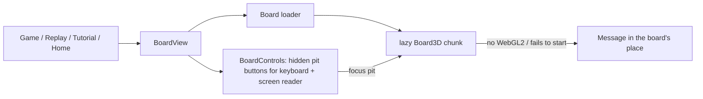

# Web design

> The web app's visual design system ("Panu"), its motion rules and the 3D board. **Status:** Draft

The source of truth is the code: tokens and components in `apps/web/src/styles.css`, the 3D board in `apps/web/src/board3d/`. This page explains the intent so changes stay consistent. The board technology is decided in [ADR 0021](../decisions/0021-3d-web-board.md).

## Look and feel

The direction is **Panu: the board on a Cape Verdean cloth.** Indigo and cotton white come from panu di terra, the islands' strip cloth; star yellow and red from the flag; basalt ink from Fogo. Everything else stays quiet, so the board and the seeds lead.

| Token | Light (cotton) | Dark (indigo night) | Use |
|---|---|---|---|
| `--bg` / `--surface` / `--surface-2` | `#f5f1e8` / `#fffdf8` / `#f8f4ec` | `#0b1024` / `#121a38` / `#18214a` | Page, cards, raised areas |
| `--ink` / `--ink-2` / `--muted` | basalt `#14171f` / `#3b4152` / `#5f6678` | cotton `#f3efe6` / `#c9cbe0` / `#9097b8` | Text |
| `--indigo` | `#1f2d78` | `#9aa8ff` (text, outlines, selected); fills `#3346b8` | The brand, links, selected states, "you" |
| `--star` | `#f7d116`, edge and lip `#8f6b00` | same | The one action that starts or continues a game, playable pits, wins |
| `--red` | `#c8202a` | `#ff6b6b` | Captures, the opponent, danger |
| `--green` / `--sea` | `#1a774a` / `#0c7580` | `#4cc38a` / `#4fd1dc` | Rating up and success / hints and info |
| `--focus` | `#2346d6` | cotton `#f3efe6` | The keyboard focus ring (never the primary's yellow) |
| `--night` / `--night-2` | `#0b1024` / `#141e4d` | same | The hero, the stage behind the board, the result band |

- **Contrast:** every text pair is 4.5:1 or more on the page and each surface, in both themes; focus rings and the yellow button's edge 3:1 or more. `styles.contrast.test.ts` reads the tokens from the stylesheet and checks each pair, so a token change that breaks one fails the tests.
- **One yellow:** star yellow marks the one button on screen that starts or continues a game (`.button--play`): Play now, Start game, Continue, Keep playing, Play again, Rematch, Accept an invitation, Challenge. Every other primary action is indigo (`.button--primary`). Where two game actions would show at once, one steps down to indigo (`NewGameForm`'s `start` prop): on Home the hero's button is yellow and the form's Start game indigo; on the Game page Continue is yellow while a game is in progress.
- **Players:** you are indigo and the opponent is red: nameplates, store counts, and the sleeves of the sowing hand.
- **Dark mode** follows the system (`prefers-color-scheme`) and redefines the same tokens. `index.html` sets a matching `theme-color` for each scheme; the PWA manifest uses indigo and night.
- **Type:** *Bricolage Grotesque* (display, headings, scores, counts, ratings and clocks; its optical-size file, so large sizes tighten) and *Figtree* (interface). Both are variable fonts, **self-hosted** through `@fontsource-variable` packages, and their latin and latin-ext files are in the offline precache. No font CDN. Every number uses `tabular-nums`. Labels are sentence case, never small caps.
- **The mark:** ten ouri seeds in a ring, one of them star yellow (`SeedRing` in `components/Icons.tsx`). It reads as an O, as a pit seen from above, and as the flag's ring of ten islands, made of the game's own seeds. The hero's wordmark (`Wordmark`) is "Ouril" in Bricolage ExtraBold outlines with the seed ring as its O; the heading's text stays `t('app.title')` for screen readers. The app icons (`public/icons/`) are the ring in cotton on indigo, inside the maskable safe zone.
- **The panu strip:** stitched seams and white lozenges on indigo (`--panu-strip`), used sparingly: under the hero, along the top of featured cards (`.card--accent`), on the heritage and About bands, in the result dialog's band. The 3D board lies on a cloth of the same family (see below).
- **Icons:** inline SVG in `components/Icons.tsx` on a 2 px rounded stroke, always `aria-hidden`, next to visible text.
- **Layout:**
  - On desktop, a sticky top bar holds the mark and wordmark, the navigation and the account link. **Buy a board** is a quiet link there on wide screens only (1,141 px and up); Home and About show the boards everywhere.
  - From 761 to 1,140 px, each nav link is an icon over a short label, so seven links and the account fit.
  - On phones (≤ 760 px) the navigation becomes a bottom tab bar of five links at most: Rules and About leave it when the signed-in links (Leaderboard, Stats) appear, and stay on Home's tiles. The header has no `backdrop-filter` on phones, because that would trap the fixed tab bar inside the header.
  - Dialogs open centred on wide screens and as bottom sheets on phones.

### Components

| Component | Rest | Pressed | Disabled |
|---|---|---|---|
| Buttons (`.button`) | 48 px (56 large), 14 px corners, a 1 px edge and a darker lip under them: 3 px on yellow, indigo and danger buttons, 2 px on neutral ones, none on outline ones | Sink 2 px (lip to 1 px), or 1 px without a lip | Flat and neutral (`--surface-3`, muted text, no lip) |
| Icon buttons, chips, tiles | Rounded, quiet | Scale to 0.97 | — |
| Choices (`.choice`) | Chips on `--surface-3`; the selected one is solid indigo (night text on light indigo in the dark) | Scale to 0.97 | — |
| Switches (`.toggle`) | Checkboxes drawn as switches, with a muted outline when off | — | Half opacity |
| Sliders | An indigo track and a star thumb | — | — |

Hover effects apply only on fine pointers; every interactive element shows the 3 px focus ring, offset 2 px.

## Motion rules

The rules come from the `emil-design-eng`, `emilkowalski-motion` and `review-animations` skills. Every animation must follow them; run `/review-animations` on changes.

- **Purpose first.** Animate to explain a change (seeds moving, a capture), to confirm an action (a press), or to orient (a dialog opening). Never as decoration, and no endless loops.
- **Frequency.** The more often something happens, the less it animates.
  - Navigation between pages doesn't animate.
  - The home hero reveal plays once per session; the sections below it are simply there (no fade-in on scroll, so nothing is hidden until it's scrolled to).
  - Keyboard-driven changes are instant.
- **Properties.** Movement uses only `transform` and `opacity`, never layout properties. Colour, border and shadow may cross-fade on state changes. Always list properties; never use `transition: all`.
- **Durations.** UI motion stays at or under 300 ms (`--dur-tap` 100 ms, `--dur-press` 160 ms, `--dur-fast` 180 ms, `--dur-base` 240 ms). Seed flights follow the game's animation speed setting.
- **Easing:**
  - entering and exiting use `--ease-out: cubic-bezier(0.23, 1, 0.32, 1)`
  - movement on screen uses `--ease-in-out: cubic-bezier(0.77, 0, 0.175, 1)`
  - never use `ease-in` for UI
- **Press feedback.** One rule: buttons sink when pressed (2 px with a lip, 1 px without, in 100 ms); icon buttons, chips and tiles scale to `0.97`. The table under Components gives every state.
- **Hover.** Hover effects apply only under `(hover: hover) and (pointer: fine)`, so touch devices don't get sticky hovers.
- **Enter from somewhere.** Nothing appears from `scale(0)`. Dialogs start at `scale(0.96)` and `opacity: 0`, using `@starting-style`.
- **Game moments.** The nameplate of the player to move takes its outline and lifts 2 px (240 ms). A win fills the seed ring one seed at a time (about 900 ms), then the confetti bursts once.
- **Reduced motion.** Keep fades and drop movement. In the 3D board, seeds snap into place and the camera stays still; highlight glows still fade.

## The 3D board

`components/BoardView.tsx` shows the board, and `board3d/` draws it.

- **Scene:**
  - The board is an extruded slab with holes, plus lathe-turned bowls and stores.
  - The wood is a procedural canvas texture (`board3d/textures.ts`).
  - Lighting uses local `Lightformer`s, plus contact shadows rendered once.
  - **The cloth:** the board lies on a panu cloth (`Cloth` in `Board3D.tsx`, texture `clothTexture` in `board3d/textures.ts`): indigo strips sewn edge to edge, stitched seams and plain lozenges, generic figures rather than a copied pano d'obra design, at low contrast so the seeds stay the clearest thing on screen (`motifs: false` leaves plain strips). It's one unlit, mipmapped plane (no lighting, no shadow map; the contact shadow lands on it), so it costs a texture read per pixel.
  - **Fallback:** devices that report 2 GB of memory or less (`navigator.deviceMemory`; Safari doesn't report it) get no cloth, and neither does a session whose first move averaged over 20 ms a frame (`FrameBudget`, remembered in `sessionStorage`). The flat night stage behind the canvas shows instead.
- **Seeds:**
  - All 48 seeds are one `InstancedMesh` with per-seed colour variation.
  - `board3d/seeds.ts` reconciles each display frame: it moves the fewest seeds between containers (pits, stores and the "hand").
- **The hand** (`board3d/Sowing.tsx`) plays every move the way a person does. It's procedural (capsules and a rounded palm, a right hand with a sleeve in the mover's colour: a bright indigo for you, so it shows on the cloth, red for the opponent), so nothing is downloaded. It reaches in from the mover's side of the table: from the camera side for you, from the far side for the computer.
  - *pickup:* it reaches into the pit, closes around the seeds and lifts them;
  - *sow:* it glides to the next pit (first half of the frame) and lets one seed fall; the seed drops with an accelerating fall and a small bounce, and the rest stay in its grip;
  - *skip:* it passes over the origin pit;
  - *capture:* it dips into the captured pit, grabs the seeds, carries them to the store and opens to drop them in;
  - *end of the move:* it withdraws off the table.
  - Collecting the remaining seeds at the end of a game, undo and resume move the seeds on an arc instead.
  - The hand follows a small keyframe track rebuilt on each display frame, starting from where it is, so it never jumps.
  - Timing: move frames play 2.2× slower on the 3D board (`PACE_3D` in `board3d/pace.ts`). Pickup and capture frames are longer than a single seed drop (`game/animation.ts`), so the grab and the carry are easy to follow.
  - All per-frame motion uses the scene clock (`board3d/clock.ts`), so it's frame-rate independent. With reduced motion there's no hand and the seeds snap into place.
- **Store counts** pop when seeds arrive, in their owners' colours (indigo for you, red for the opponent).
- **Glow rings** show the game state, each at 3:1 or more against the wood:
  - playable pits: star yellow (at rest at 75 %)
  - hover: a brighter yellow
  - keyboard focus: cotton white
  - hint and skipped pits: sea
  - sowing: a yellow pulse
  - capture: the capturer's light tint (`#b4beff` when you capture, `#ffb4b4` when the opponent does)
  - Rings rise quickly and fade slowly. Yellow on the board means only "you can play this" and the sowing pulse.
- **Camera:**
  - A fixed, angled view fitted to the screen's aspect ratio (steeper on narrow phones). There's no free orbit.
  - It pushes in gently on captures and lifts at the end of the game.
- **Seed counts** are DOM chips positioned over the canvas each frame (basalt chips with cotton numbers in Bricolage, tabular). Text stays crisp.
- **Performance:**
  - `frameloop="demand"` (draws only while something moves)
  - pixel ratio capped at 1.75
  - one draw call for all seeds

## Loading the 3D board

The 3D board is a separate chunk, so it isn't there on the first paint. `BoardView` shows a small **loading widget** in its place: three ouri seeds dropping one after another into a wooden bowl, with "Loading the board…". It's deliberately not board-shaped. The 3D board fades in over it once it has really drawn (two rendered frames).
- Keyboard and screen-reader play work at once through `BoardControls` (visually hidden pit buttons; the hinted pit is announced as the suggested move).
- If the 3D board can't run (no WebGL2) or fails to start, the board area says so (with **Try again** for a failure).
- With reduced motion the loader's seeds are still.

## The game screen

- **Rules choice:** the new-game form offers **Standard** (`cv.standard`), **Continuous sowing** (`cv.continuous`, [ADR 0023](../decisions/0023-relay-sowing.md)), **Capture across** (`cv.across`) and **Capture across + continuous** (`cv.across-continuous`, [ADR 0024](../decisions/0024-capture-across.md)); *Play again* keeps the same rules. A relay shows as another pickup: the hand reaches back into the pit and grabs its seeds. The Rules page has a tab for it. The tutorial ends with two continuous-sowing lessons and a capture-across lesson (each tutorial step names the rules it's played with, `tutorial/steps.ts`).
- **Rules:** the Rules page has one tab per playable variant (`?variant=<id>` links a tab) and shows each topic as a collapsible section (native `
`), so new variants don't make the page longer. A regional variant lists only its differences and links to the rules it's based on. In a game, the **info button** in the top bar opens the rules of the variant being played (`components/RulesView.tsx`, content in `content/rules.ts`).
- **No game in progress:** the game screen is the **New game** form itself (difficulty, who starts, then **Start game**), the same form as on the landing page (`components/NewGameForm.tsx`), in the usual layout with navigation.
- **Full screen:** while a game is on screen it takes the whole viewport (`state/immersive.ts`). There's no header or tab bar. The top row holds the menu button, the opponent's nameplate and the tools (music, rules, full screen); one status line (`role="status"`) says whose turn it is; then the board; then your nameplate with Undo, Hint and Menu. Both game screens share `components/Nameplate.tsx`: a seed-shaped avatar, the name, the score and, in live games, the clock; the player to move gets an outline in their colour. On phones the tools sit above the opponent's plate, the board runs edge to edge (in portrait the stage keeps the board's shape and the whole block centres), and Undo, Hint and Menu are icons (their names stay for screen readers). On short screens (a phone on its side) the plates and actions move into a column beside the board. The full-screen button uses the Fullscreen API where the browser allows it on page elements; iPhone Safari doesn't, so there the full-viewport layout is the full screen.
- **Game menu:** the pause button (top bar) and **Menu** open it: *Keep playing*, *Save and exit* (the game is saved after every move and resumes from the home screen, where the hero's main button becomes *Continue your game*), or *Forfeit game*, after a confirmation. The home page's resume card offers the same **Forfeit game**, with the same confirmation (`game/forfeit.ts` is shared), and starting a new game while one is unfinished forfeits it (the form warns first; this applies even to a game with no moves yet). A forfeit is a loss and is recorded like any game ([ADR 0022](../decisions/0022-forfeit-and-record-format-2.md)).
- **Score feedback:** when seeds are captured, the score pops (280 ms) and a "+N" rises from it. The number itself changes at once, so it's never behind the game.
- **End of game:** the result dialog has an emblem, a short tagline and the final score counting up once. The design follows common practice for victory and defeat screens:
  - every result leads with the seed ring on a band with the panu strip;
  - only a **win** celebrates: a night band, the ring filling one seed at a time, and a short burst of confetti in the Panu colours, led by ten star-yellow seeds and with a few grey ouris among them (no stars, so it never reads as another flag);
  - a **loss** is calm basalt, with no confetti, and its main button says **Rematch**;
  - a **draw** is sea.
  - Everything is skipped with reduced motion.

- **Online games** (`/online/:id`, `routes/OnlineGame.tsx`): once a game against another player has started, it's this same screen: the whole viewport and the game music, every move (yours at once, before the server answers; the opponent's when it arrives) sown seed by seed with its sounds and announced, the opponent's nameplate, the rules, full screen, and the menu (*Keep playing*, *Back to your games*, *Resign* after a confirmation). The result dialog says who resigned or ran out of time and offers **Rematch** (a new invitation to the same player, rated or casual like this one). For a rated game it also shows how each rating moved (overall and the variant's, before → after, the change in green or red), or why the game didn't count. The celebration and end sound play only when the game ends on screen, not when a finished game is opened later. Undo and hints are left out: the moves are on the server, and a hint would be the computer playing for you. An invitation is still a plain page with **Accept** and **Decline**. **Live games** ([ADR 0033](../decisions/0033-live-games-http-moves-and-relay.md)) add each player's clock under their score (`role="timer"`; dark while it runs, red under 20 s), counted down from the server's snapshot corrected by `server_now` (`online/clock.ts`); at zero the screen asks the server, which settles the flag fall. Until both players have moved, a note gives the 30-second first-move window and the menu offers **Call off the game**. A called-off game is a plain page saying so. The menu offers **Offer a draw** once both players have moved (turn-by-turn games too); an offer from the opponent shows as a card above the actions with **Accept the draw** and **Keep playing**, and your own as a note until the next move. The screen listens to the relay (`online/useRelay.ts`) and refetches the game on each event; without the relay it polls every second.

## The landing page

- **Hero:** full-bleed indigo night with the panu strip along its bottom edge. It has the wordmark (the seed ring as its O), two calls to action, and a **live board** on its cloth: the computer playing itself with the hand, so the page shows how the game works.
  - **Play now** (star yellow) starts a game at once with the choices last used in the new-game form on this device (`game/lastNewGame.ts`; the defaults the first time); with a game in progress it's **Continue your game**. **Learn to play** opens the tutorial.
  - The live board plays only while it's on screen. It stops after ten moves (no endless loop) and stays still with reduced motion.
  - The reveal (copy, the ring's seeds, board) plays once per session.
- **Sections:** quick start (difficulty and who starts; with accounts on, the Game page's tabs choose **Against the computer** or **Online**, the lobby for signed-in players and a sign-in prompt for guests), *How to play* in four steps, *Ten islands, one board* (heritage on a night band with the seed ring: the seeds, the ouris, come from the ourinzeira shrub, and the app's cloth pattern from panu di terra, with its history), *Made to play anywhere* (features, as plain columns), and links to the rest of the app. The quick start's Start game is indigo there, since the hero holds the page's yellow action.

## Signed-in features and other content

- **Leaderboard** (`/leaderboard`, `routes/Leaderboard.tsx`, signed-in players, in the menu; [ADR 0034](../decisions/0034-ratings-and-leaderboards-in-postgres.md)): your ratings per pool (provisional ones with a `?`), then a board: **Ranking** (Overall, or a variant and mode) and **World** or your country (named after it; with no country set, a link to Settings). The top 100 in a table (rank, player with handle and country, rating, games), your row on a soft star tint, or pinned below a dashed line when you're outside the top; the top three ranks sit on seed medals (star, silver, copper). The pool and scope are in the URL. **Settings → Profile** has the **Country** picker (names from `Intl.DisplayNames`, codes in `content/countries.ts`). The online lobby has a **Rated games** switch and a **Game pace** choice (turn by turn, or a live clock: 3 + 2, 5 + 3, 10 + 5) for new invitations, links and challenges; casual and live games are tagged in the lists. **Play now** pairs you with someone for a chosen clock: while looking, it shows how many players are looking and a **Cancel** button, repeats the seek every 3 s as a heartbeat, and opens the game when matched (from the answer or the relay). The search lives in `online/LiveSeekProvider.tsx` (mounted in the layout), so **Play the computer while you wait** keeps it going: elsewhere in the app a small notice (`SeekToast`, over everything, including the computer game) shows the search with **Cancel**, and then "Opponent found!" with **Open the game**. Below, **Waiting for an opponent** lists open seeks from other players (refreshed every 5 s) with **Play** to join one directly.
- **Points board** (on the Leaderboard page, **Ratings** / **Points this season** above the boards, `?board=points`): how points are earned, a **Season** picker (months with points), World or your country, and a table of rank, player, points and games (online plus wins against the computer).
- **Player profiles** (`/players/:id`, `routes/Profile.tsx`, signed-in players): opened from leaderboard rows and names in the online lobby. Name, handle, country and start date, **Challenge** (a rated invitation, then the lobby), your record against them, top-placement badges, and a card per pool with the rating and a small chart (`components/RatingChart.tsx`: one 2 px line in `--indigo`, muted axis labels, a crosshair and tooltip on hover, and a visually hidden table of the same points).
- **Game menu** (`/game`, `routes/GameHub.tsx`): one place to choose who to play. Tabs **Against the computer** (continue the game in progress, or the new-game form; the game itself is at `/play`) and **Online** (when accounts are on: the lobby for signed-in players, a sign-in prompt for guests). The tab is in the URL (`?tab=online`); `/online` redirects there. **Game** stays highlighted on `/play` and `/online/:id`.
- **Usage statistics** (`src/telemetry/`, [ADR 0026](../decisions/0026-usage-statistics-with-matomo.md)): only after the player opts in on the first-launch prompt or in Settings ([ADR 0014](../decisions/0014-telemetry-consent.md)), and only when the build sets `VITE_MATOMO_URL` and `VITE_MATOMO_SITE_ID`. Each consent option appears only when its service is configured. A small client for Matomo's HTTP API (no `matomo.js`, no cookies) records a screen view per route and the events below, queues them in `localStorage` (capped, dropped after 23 hours) and sends them in bulk when online. `GuestNetwork.test.tsx` checks that a guest who declines sends nothing and one who opts in only reaches Matomo.
  - **Screen paths** are cleaned before they leave the device (`sanitizePath`): no query string or fragment, and route parameters become their names (`/replay/:id`, `/online/:id`, `/join/:code`; an invite code would let anyone join the game). Any other segment that looks like an ID (a UUID, or 16+ characters with a digit) becomes `:id`.
  - **Events** say what happened, never who: no account, handle, game ID or invite code.

    | Event | Properties | When |
    |---|---|---|
    | `game_finished` | `level`, `outcome`, `plies` | A game against the computer ends (or is forfeited) |
    | `music_playlist_open` | | The player opened the music's YouTube playlist |
    | `sign_in` | `provider` (`google`, `dev`) | A sign-in succeeds |
    | `sign_out` | | The player signs out |
    | `account_deleted` | | The account is deleted |
    | `online_invite` | `via` (`handle`, `link`, `opponent`) | The server accepted a new invitation |
    | `online_invite_answer` | `answer` (`accept`, `decline`, `cancel`) | An invitation was accepted, declined or withdrawn |
    | `online_join` | | An invite link was used to join a game |
    | `online_game_finished` | `outcome` (from your side), `reason`, `plies` | A game against another player ends while it's open in this app; each player counts their own |

    Add new events to this table and to the privacy policy's usage-statistics paragraph.
- **Feature flags** (`src/features.ts`): sign-in, accounts and sync (`VITE_FEATURE_ACCOUNTS`) and the Stats page with history and replays (`VITE_FEATURE_STATS`) are **off by default** in code; production builds turn both on through the GitHub variables `VITE_FEATURE_ACCOUNTS` and `VITE_FEATURE_STATS` (`deploy-web.yml`). Stats are also only for signed-in players (`useStatsVisible`): guests get no Stats link, and `/stats` and replays send them to sign in. The page has two sections, against the computer (`mode = vs_ai`) and against other players (every other mode, empty until such games exist). Their code stays in place; with a flag off, its links, routes and settings are hidden. Unit tests run with both on, and `features.test.tsx` checks a build with both off.
- **About the developer** (`/about`): photo, introduction, social links and *Buy me a coffee* (PayPal, Venmo, Zelle). The content lives in `src/content/developer.ts`; empty links and usernames are hidden in production and shown as dashed placeholders in development. PayPal and Venmo open their pages; Zelle has no web link, so its email or phone is shown with a copy button.
- **Play on a real board:** two recommended physical boards (classic and premium) linking to Amazon, at the bottom of the About page (`/about#buy`) and on the home page. The header's **Buy a board** link (wide screens only) opens the About page and scrolls there. Links live in `src/content/boards.ts`; set `affiliate: true` for Amazon Associates links, which adds the required disclosure and `rel="sponsored"`. Empty links are hidden in production, with the header button.
- **Game music** (`src/audio/`): plays only while a game is on screen. Every MP3 in `public/audio/game/` is a track (a build plugin lists them as `virtual:music-tracks`, so adding music is just adding files). A random track plays, and when it ends a different random one follows. The game's top bar has the music controls joined as one group (`components/MusicControls.tsx`): **Pause/Play music**, **Next track** (while playing), and a playlist link whose tooltip says the music is a YouTube playlist; it opens the playlist (`content/music.ts`) in a new tab (`noopener noreferrer`). The app itself never contacts YouTube: only the player's click does. Settings → Music has the same on/off switch and the volume (per device, kv `music`, not synced). Music starts after the first tap, click or key press, pauses while the tab is hidden, and a file that fails to load is dropped from the playlist. For offline play the tracks are downloaded into their own service-worker cache (`ouril-music`, range requests supported, only real MP3 responses stored) while the browser is idle; on Vercel, missing `/audio/` files return 404. The UI only calls `setMusic`, `skipTrack`, `hasMusic` and `cacheMusic`, so a streaming service could later sit behind the same functions.
- **Coming soon** (landing page): ids listed in `src/content/comingSoon.ts`, with `home.soon.<id>.title|body` strings. Empty = hidden in production, placeholders in development.

## Testing

- jsdom has no WebGL, so component tests play through `BoardControls`, the 3D board's hidden controls (`components/BoardControls.test.tsx`). `board3d/seeds.test.ts` replays real games through the reconciler.
- The 3D board is checked visually in a real browser (Chrome with SwiftShader works without a GPU): the landing page, a move being sown, a capture, keyboard focus, dark mode, the loader and the result dialogs. The redesign's screenshot matrix: 1440 × 900 and 390 × 844 in light and dark, plus 360 × 740, 844 × 390 and 1024 × 768. Software rendering is slow enough to trip the cloth's frame budget, so take the game screenshots in a fresh browser context (a board that already played a move has dropped the cloth for the session).
- `styles.contrast.test.ts` checks the token contrast pairs in both themes.
- Software rendering is too slow to judge motion in real time. Install Playwright's fake clock (`page.clock`) and step through a move instead: each screenshot then shows an exact moment (the tutorial's capture step is a good one).

## Open questions

- Streaming music (for example Spotify) instead of, or alongside, the bundled game tracks.

- A native look that matches the web 3D board on iOS and Android (SceneKit/RealityKit, Filament), or a simpler board there ([ADR 0008](../decisions/0008-native-apps-per-platform.md)).
- Sound design for sowing and captures (off by default, respecting a mute setting).
- A tap to fast-forward the rest of a long move (laps of 12+ seeds take about 5 s in 3D).
- Alternative board skins (lighter wood, stone) and seed types (other seeds, pebbles).
- An upright board on portrait phones: turning the camera a quarter turn makes the pits 1.3 to 1.6 times bigger but the far store smaller, and the hand would cross your own row. It needs a flagged prototype, measured pit sizes on four screens and ouril players trying both orientations.
- A side rail instead of the top bar, once the signed-in links outgrow it.
- The cloth's cost on a real low-end Android phone (frame times during a 12-seed lap, with and without it); today's guard is the 20 ms frame budget.
- Reactions to the seed-ring mark and the cloth from Cape Verdeans on several islands and in the diaspora, before the mark is final; and a blur test (Home and the win dialog, blurred) to check the identity holds without the pattern.
